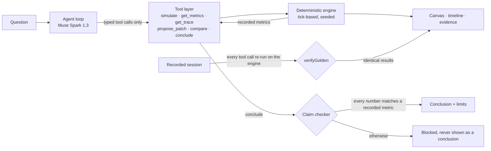

# LivingDiagrams

**An agent that investigates why a backend design fails.** Muse Spark runs controlled experiments on a deterministic simulator, tries fixes (and rejects the ones that do not hold up), and may only state conclusions whose numbers match metrics the engine recorded. Anything else is blocked, not shown.

Built for the Meta Global AI Developer Hackathon: **Build for Your World**, Indie Developer track.

- **Demo video (3 min):** _TODO before submission: add the link_
- **Hosted replay (no key, convenience only):** _TODO: add the link if published_
- **Run it locally:** three commands, below. No account, database or API key is required to see everything except the live agent.

## The problem

You add a retry or a circuit breaker to a service and cannot tell whether you helped or made an outage worse. A chatbot gives a confident answer you cannot verify. LivingDiagrams turns that question into experiments on a small, explicit model, and shows its work: every number links to a recorded run.

> _Author's note to add before submission: the firsthand story behind this, in your own words._

## Run it

Requires Node.js 20.9 or newer (developed on 22).

```bash
git clone https://github.com/MohamedAfrasDev/living-diagram.git
cd living-diagram
npm install
npm run dev
```

Open http://localhost:3000.

| | Without an API key | With an API key |
|---|---|---|
| Simulator, manual runs, charts | live, in the browser | live, in the browser |
| Recorded agent session | **Replay**, labeled; verified against the live engine before it is shown | same |
| "Ask the agent" | shows a notice and falls back to Replay | runs the live Muse Spark agent |

To run the live agent, copy the example file and add your key (PowerShell: `Copy-Item .env.example .env.local`):

```bash
cp .env.example .env.local
# edit .env.local and set MODEL_API_KEY=<your Meta Model API key>
```

The key is read only by the server route and never reaches the browser. Other commands: `npm test` (113 tests), `npm run build`, `npm run lint`.

## What you will see

1. **System:** five nodes (Gateway, Order, Cache, Payment, DB) with busy-slot and queue gauges that animate from the engine's own recorded state. Payment is 20× slower. Play, pause, speed and a time slider; a table alternative.
2. **Agent investigation:** every tool call and result, blocked statements shown as blocked, then the conclusion with its limits. "Replay recorded run" steps through a real session.
3. **Evidence:** any two runs under matched seed and fault, with error rate and degraded rate side by side, per-node detail, and the run hash.
4. **Run it by hand:** the four knobs (`timeoutMs`, `retries`, `circuitBreaker`, `bulkhead`) on the same engine, no agent needed.

What the engine shows for the default scenario (seed 1, 500 requests at 50 per second, template parameters):

| Run | Error rate | Degraded | Payment attempts per request | p95 latency |
|---|---|---|---|---|
| Healthy | 0.0% | 0.0% | 1.00 | 48 ms |
| Payment 20× slower | 94.0% | 0.0% | 1.00 | 838 ms |
| Fault + `retries=3` | 91.8% | 0.0% | 3.80 | 2,968 ms |
| Fault + circuit breaker | 16.0% | 65.6% | 0.34 | 848 ms |

Retries did **not** raise the error rate in this model; they multiplied downstream load and tail latency. The breaker cut errors by more than half, at the cost of serving most requests degraded. The UI always shows those two rates together.

## How it works



- **Engine** (`lib/engine/`): plain TypeScript, tick-based, integer milliseconds, no network or model calls. Same seed gives the same result. It never imports the agent.
- **Tools** (`lib/agent/tools.ts`, `lib/contracts/`): the agent acts only through typed tools. Unknown tools or fields are rejected, not guessed. Budgets: 8 simulations, 24 tool calls. The model sees metric summaries and selected traces, never the event stream.
- **Claim checker** (`lib/agent/claims.ts`): each number in a conclusion needs a reference (metric, knob, seed, ratio or difference) that matches the recorded value at the stated precision. Spelled-out numbers, causal wording without a recorded comparison, and "the error rate went up/down" claims that contradict the data are blocked.
- **Replay** (`lib/agent/replay.ts`): the recorded session is only shown after every recorded tool call is re-executed on today's engine and returns exactly the recorded result. Any mismatch is a visible error. It carries a persistent "Replay" label and is never presented as a fresh run.
- **Server** (`app/api/agent/route.ts`): holds the key, streams the investigation as NDJSON, one at a time, and answers `NO_API_KEY` so the UI can fall back to Replay.

## How Meta's models are used

- **Muse Spark 1.3** (`muse-spark-1.3`) through the **Meta Model API** Responses endpoint, with function tools. It is the agent: it chooses which experiments to run, reads the metrics, proposes and rejects changes, and writes the conclusion.
- No other model is used at runtime. The simulator is deterministic code and does not call any model.
- The conversation history is sent in full each turn (no server-stored responses), after the spike hit provider-side persistence errors.

## Results, including the misses

Everything below is in `docs/` with transcripts in `data/runs/`.

| Check | Result |
|---|---|
| Unit and integration tests | 113 passing: engine golden and invariant tests, tool layer, claim checker, loop with a scripted provider, replay verifier, UI helpers |
| Tool-calling spike (10 runs) | **9 of 10** after correcting my scorer. The first scorer gave 6 of 10 because it rejected the model's own tool arguments, and one run hit a provider error (D-023) |
| Agent test, trial 1 (6 live runs) | valid calls 6/6, **confirmed fix 3/6 (bar was 4: missed)**, unsupported numbers 0 |
| Agent test, trial 2 | after one sentence in the system prompt defining the default settings: valid 6/6, **confirmed fix 5/6**, unsupported numbers 0. Trial 1 stays on record; the prompt change was made after seeing it (D-027, D-028) |

Honest notes:

- The agent chose only seeds 1 and 2 in all 12 runs, and never tried a wrong fix first on its own, so "self-corrects" is 0 of 12. It did test retries as a counterexample and reject them.
- The scenario was changed once after its first run did not exercise the knobs (D-014 to D-016), and the definition of a "bad fix" was changed after that (D-017). Both are logged with the numbers.
- The tester check (3 people) has not been run yet.

## Known limits

- It models one template system: five nodes, four knobs, one fault. Every capacity and service time is an assumption, not a measurement. Results describe the model, not your system; measure before making a capacity decision.
- Virtual time only. No claim about real-world latency, throughput or cost.
- A fix is "confirmed" by the rule in `docs/decision-log.md` (D-017): under the fault on two seeds, error rate at most half of the fault alone, degraded share reported, healthy system undegraded. Other definitions would give other answers.
- The recorded replay was captured with the system prompt from before the baseline sentence was added; the agent's behavior for that question is the same in trial 2.
- Out of scope on purpose: accounts, a database, image import, other fault types, hosting a live agent with a shared key.

## Built during the hackathon

The building period is Oct 27 to Nov 4, 2026. The first commit (Oct 27) is the unmodified `create-next-app` boilerplate (`app/` scaffold, `package.json`, `README.md`). Everything else in this repository was written from Oct 28 on: the engine (`lib/engine/`), tool layer, claim checker, agent loop and provider (`lib/agent/`), contracts, the server route and UI (`app/`), the golden-run builder and agent test scripts (`scripts/`), the recorded runs (`data/`, `public/golden/`), and all documentation and tests. No code from before the event was reused.

Development used Claude Code (Anthropic) as a coding assistant, working from the specs in `docs/`. Scope, decisions and the acceptance of results are recorded in `docs/decision-log.md`.

## Repository map

| Path | What |
|---|---|
| `lib/engine/` | simulator, scenario constants, seeded generator |
| `lib/agent/` | tools, claim checker, loop, Meta provider, prompt, replay verifier |
| `lib/contracts/` | tool and claim contracts shared by agent and UI |
| `lib/ui/` | pure helpers for the interface |
| `app/` | the workspace UI and `/api/agent` |
| `public/golden/` | the recorded agent session (served as a static file) |
| `data/runs/` | transcripts of both agent-test trials |
| `scripts/` | spike, agent test and golden-run builder |
| `docs/` | specs 01 to 07 and the decision log |

## License

MIT. See `LICENSE`.
