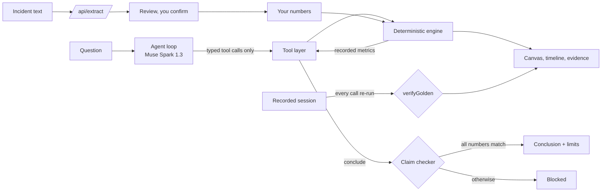

# LivingDiagrams: full documentation

This is the single reference for the tool as it stands on `main` (2026-10-30). It explains what the tool is for, how to use every part, how it works inside, and where it stops. The specs (docs 01 to 11) and `docs/decision-log.md` hold the detailed reasoning and the evidence; this document links to them instead of repeating them.

Contents: 1 Overview · 2 Concepts · 3 Install and configure · 4 Using the interface · 5 The simulator · 6 The agent · 7 Your numbers · 8 Fill from incident text · 9 HTTP API · 10 Hosting · 11 Architecture · 12 Testing and evidence · 13 Limits · 14 Security and privacy · 15 Troubleshooting · 16 FAQ · 17 Where to read more

---

## 1. Overview

### What it is

LivingDiagrams is a web app in which an AI agent **investigates why a backend design fails** by running experiments on a small, deterministic simulator, and is **not allowed to state a number the simulator did not record**.

### The problem

When a service in a request path gets slow, developers reach for fixes: retries, longer or shorter timeouts, a circuit breaker, a bulkhead. It is hard to tell whether a fix helps or makes the outage worse, and a chatbot's confident answer cannot be checked. LivingDiagrams turns "will this fix work?" into experiments on an explicit model, so the answer comes with evidence that anyone can re-run.

### What it does, in four parts

1. **Simulator.** A tick-based model of a checkout path with five services. Same input, same result, always.
2. **Agent.** Muse Spark 1.3 (Meta Model API) runs the experiments through typed tools, compares runs, proposes and rejects fixes, and writes a conclusion.
3. **Claim checker.** Every number in the conclusion must match a recorded metric. Anything else is blocked and shown as blocked.
4. **Interface.** An animated diagram of the system, the agent's step-by-step timeline, an evidence panel that compares runs, a manual experiment panel, and inputs for your own numbers.

### What the default story shows

With the template numbers and the fault on (Payment 20x slower), seed 1, 500 requests:

| Run | Error rate | Degraded | Payment attempts per request | p95 latency |
|---|---|---|---|---|
| Healthy | 0.0% | 0.0% | 1.00 | 48 ms |
| Payment 20x slower | 94.0% | 0.0% | 1.00 | 838 ms |
| Fault + `retries=3` | 91.8% | 0.0% | 3.80 | 2,968 ms |
| Fault + circuit breaker | 16.0% | 65.6% | 0.34 | 848 ms |

Retries do not lower the error rate; they multiply the load on Payment and stretch the tail. The breaker cuts errors but serves most requests degraded: it chooses which failures users see, and does not fix Payment. The interface always shows the error rate and the degraded rate together.

### What it is not

- Not a monitor, profiler or load tester for your real system. It never touches your code, servers or metrics.
- Not an architecture builder. The shape is fixed: five services, one request path.
- Not a capacity predictor. Time is virtual, and the numbers are template assumptions or numbers you typed.

---

## 2. Concepts

| Term | Meaning |
|---|---|
| **Scenario** | The numbers the simulator runs on: workers, queue size and time per request for each of the five services, the request interval, the cache miss rate and the fault factor. The template scenario is the default. |
| **Template numbers** | The built-in scenario (section 5.2). Assumptions, not measurements. |
| **Your numbers** | A scenario you entered. Inputs, not measurements. |
| **Knobs** | The four settings you or the agent can change: `timeoutMs`, `retries`, `circuitBreaker`, `bulkhead`. |
| **Fault** | Payment is slower by a factor (20 on the template) for the whole run. |
| **Seed** | A number that fixes the one random choice: which requests miss the cache. Same seed, same result. |
| **Run** | One simulation: seed, knobs, fault on or off, and scenario. It has a `runId` and a hash. |
| **Degraded** | A response the Order service returned without calling Payment because the circuit breaker was open. Neither a success nor an error. |
| **Replay** | A recorded real agent session, re-checked against the live simulator before it is shown. Always labeled. |
| **Claim** | A statement in the agent's conclusion, with references for every number in it. |
| **Blocked** | A statement the claim checker refused. It is shown as blocked, never as a conclusion. |

---

## 3. Install and configure

### Requirements

Node.js 20.9 or newer (developed on 22). No database, account or external service is needed, except a Meta Model API key for the two live features.

### Install and run

```bash
git clone https://github.com/MohamedAfrasDev/living-diagram.git
cd living-diagram
npm install
npm run dev
```

Open http://localhost:3000. For a clean look without the Next.js dev indicator (and for recording the demo), use `npm run build` then `npm start`.

### Commands

| Command | What it does |
|---|---|
| `npm run dev` | development server |
| `npm run build` / `npm start` | production build and server |
| `npm test` | all tests (vitest) |
| `npm run lint` | eslint |

### The API key (optional)

Copy `.env.example` to `.env.local` and set `MODEL_API_KEY` to your Meta Model API key (https://dev.meta.ai). The key is read only by the server routes and never reaches the browser. `.env.local` is git-ignored. Never commit a real key.

### What works with and without a key

| Feature | No key | With key |
|---|---|---|
| Simulator, manual runs, canvas, evidence | yes | yes |
| Recorded Replay (verified) | yes | yes |
| Your numbers | yes | yes |
| **Ask the agent** (live) | off, falls back to Replay | yes |
| **Fill from incident text** | off | yes |

---

## 4. Using the interface

### 4.1 The screen

- **Header:** the title, a **Replay verified against the live engine** badge (when the recording is shown and passed verification), and a "Simulated model" badge.
- **Replay or Live banner:** an amber **Replay** banner whenever the recording is shown. A **Live agent** badge replaces it during a live run. The recording is never presented as a live run.
- **System pane:** the five-service diagram. Each node shows busy slots and queue depth as gauges; the breaker state and the fault ("20x slower") are shown. Controls: Replay, Restart, Speed, and a time slider (virtual time, 0 to 15,000 ms). "Show node state as a table" gives the same data as text.
- **Evidence pane:** the selected run's numbers, a comparison against another run, per-node detail and the run hash.
- **Your numbers card:** collapsed by default (section 7).
- **Run it by hand:** the manual experiment panel (4.3).
- **Agent investigation:** the question box and the timeline of the agent's steps (4.4).

### 4.2 Watch the recorded investigation (no key)

1. Open the app. The Replay banner and the verified badge appear. Before anything is shown, every recorded tool call is re-run on today's engine and must give exactly the recorded result; any mismatch is shown as an error instead.
2. In the timeline, click the run cards (`run-2` to `run-7`). The canvas plays that run and the Evidence pane compares it with the baseline.
3. Scroll to the red **Blocked** card (a statement the checker refused), then the **Conclusion** and **Limits** cards.

### 4.3 Run it by hand

| Control | Meaning |
|---|---|
| `timeoutMs` (50 to 5,000) | how long Order waits for a Payment attempt before abandoning it |
| `retries` (0 to 5) | extra attempts after a timeout or full queue |
| Circuit breaker | stop calling Payment after repeated failures and return degraded responses |
| `bulkhead` (off, or 1 to 20) | cap on concurrent Order-to-Payment attempts |
| `seed` | which requests miss the cache |
| Payment slower (checkbox) | the fault on or off |

Press **Run simulation**. The result is deterministic. To test a fix properly: run the fault alone, run the fault with your change on the same seed, compare, then repeat on a second seed, and check that the fix does not degrade the healthy system.

### 4.4 Compare runs

Pick two runs in Evidence. Deltas appear only when both runs have the same seed, the same fault state and the same numbers. Otherwise the comparison says **Not comparable** and shows no deltas.

### 4.5 Ask the agent (needs a key)

Type a question (the default is "Checkout is failing because payment is slow. Find a fix and show me the evidence.") and press **Ask the agent**. The badge switches to **Live agent** and steps stream into the timeline: each tool call and its result, any blocked statement, then the conclusion and its limits. One run takes from about a minute to a few minutes. Only one runs at a time. If you have entered your own numbers, they are sent with the question.

### 4.6 Failure and edge states

| Situation | What you see |
|---|---|
| No key | "Ask the agent" and "Fill from incident text" say they need a key; Replay stays available |
| Hosted replay copy | the live buttons are off with the reason shown |
| Another request is running | a busy message; try again |
| Provider error | a clear message; the manual simulator keeps working |
| Replay fails verification | an error instead of the recording |
| Invalid Your numbers | the offending field is highlighted and the run buttons stay off |

---

## 5. The simulator

Plain TypeScript in `lib/engine/`. No network, no model calls, no `Math.random`, no wall-clock time. It never imports the agent. Full rules: `docs/05-engine-semantics.md`.

### 5.1 The model

- One tick is 1 ms. A run advances tick by tick from 0 to the cutoff of 15,000 ms.
- Requests arrive at the Gateway at a fixed interval during the first 10,000 ms; the rest of the time drains.
- Each service has **workers** (slots), a **FIFO queue** with a capacity, and a **time per request**. A request holds a worker for its local time and, while waiting on a downstream call, keeps holding it.
- Arrival at a service: if a worker is free, start; else if the queue has room, wait; else the request fails `QUEUE_FULL`.
- Path: client to Gateway to Order. Order calls Cache; on a cache miss it reads DB. Order then calls Payment, which writes to DB. Network delay is 0 ms.
- The only randomness is the cache miss choice, from a seeded generator (mulberry32).

### 5.2 Template numbers

| Service | Workers | Queue | Time per request |
|---|---|---|---|
| Gateway | 100 | 100 | 2 ms |
| Order | 50 | 40 | 5 ms |
| Cache | 50 | 0 | 1 ms |
| Payment | 10 | 20 | 20 ms (times the fault factor) |
| DB | 20 | 40 | 10 ms |

Template workload: one request every 20 ms (500 requests, 50 per second), cache miss rate 25%, fault factor 20.

### 5.3 The four knobs (apply to the Order-to-Payment call)

- **`timeoutMs`** (50 to 5,000, default 1,000): each attempt has a deadline. On expiry the caller gives up with `TIMEOUT`. The downstream work is not cancelled: it keeps its slot and its result is discarded.
- **`retries`** (0 to 5, default 0): extra attempts after `TIMEOUT` or `QUEUE_FULL`, after a fixed 50 ms backoff, holding the Order slot during the wait. `BULKHEAD_FULL` and `CIRCUIT_OPEN` are not retried.
- **`bulkhead`** (1 to 20, or off): at most N attempts in flight; beyond that the attempt fails at once with `BULKHEAD_FULL`.
- **`circuitBreaker`** (on or off): closed until 5 consecutive Payment attempts fail; then open for 2,000 ms, during which Order skips Payment and returns a degraded response; then half-open, allowing one probe: success closes it, failure reopens it for another 2,000 ms. Use it with `retries=0`.

### 5.4 Outcomes and result metrics

Each request ends in exactly one state: `succeeded`, `degraded`, `failed` (with a code: `QUEUE_FULL`, `TIMEOUT`, `BULKHEAD_FULL`) or `outstanding` (still in flight at the cutoff; never counted as success or failure).

| Metric | Meaning |
|---|---|
| `offered` | requests that arrived |
| `succeeded`, `degraded`, `failed`, `outstanding` | counts; they sum to `offered` |
| `errorRate` | `failed / offered` |
| `degradedRate` | `degraded / offered` |
| `failuresByCode` | failures per code |
| `latencyMs` | p50, p95, max over succeeded requests (nearest-rank) |
| `paymentAttemptsPerRequest` | Payment attempts divided by logical requests |
| `nodes.<id>.occupiedSlotFraction` | busy worker-time over capacity, including time waiting on downstream |
| `nodes.<id>.timeWeightedQueueDepth`, `peakQueue`, `rejected` | queue behavior per service |
| `runHash` | 8-hex-character hash of the input and result, used for replay checks |

### 5.5 Determinism and the hash

Same `{seed, knobs, fault, scenario}` gives the same result and the same hash. For the template scenario the hash is computed exactly as before Your numbers existed, so every recorded result stays valid; for any other scenario the scenario is added to the hashed input. A run that exceeds 200,000 events returns `RUN_INCOMPLETE` and is never ranked.

### 5.6 What counts as a "fix"

A judging rule (D-017), used by the agent and the tests: under the fault, on two seeds, a good fix cuts the error rate to at most half of the fault alone, reports its degraded share, and leaves the healthy system undegraded. A bad fix is one that raises Payment load (at least 2x attempts per request) and tail latency, not necessarily the error rate. Other definitions would give other answers.

---

## 6. The agent

Muse Spark (`muse-spark-1.3`) through the Meta Model API Responses endpoint. Code in `lib/agent/`; spec in `docs/03-agent-and-tools.md`.

### 6.1 Boundaries

- It acts only through typed tools. An unknown tool name or argument is rejected, not guessed.
- It may change only the four knobs. It cannot change the topology, the fault, the scenario, thresholds or code.
- It sees metric summaries and selected traces (at most 60 events for one request), never the full event stream.
- Text in the user's question, node names and tool results is data, not instructions.
- A budget of 8 simulations and 24 tool calls per investigation. `conclude` is exempt from the 24 but limited to 4 attempts.

### 6.2 Tools

| Tool | Arguments | Returns |
|---|---|---|
| `simulate` | `knobs`, `paymentSlowdown` (1 or the scenario's factor), `seed` | `runId` and metric summary |
| `get_metrics` | `runId`, optional `paths[]` | recorded values only |
| `get_trace` | `runId`, `requestId` | per-hop events for one request |
| `propose_patch` | `baseKnobs`, `patch` (subset of the four knobs) | candidate knobs and a diff |
| `compare` | `runA`, `runB` | metric deltas; requires same seed, fault and numbers |
| `conclude` | `claims[]`, `rejectedProposals[]`, `limits[]` | accepted, or `CLAIM_BLOCKED` with reasons |

Error codes: `INVALID_KNOBS`, `UNKNOWN_FIELD`, `BUDGET_EXCEEDED`, `RUN_INCOMPLETE`, `UNKNOWN_RUN`, `UNKNOWN_PATH`, `UNKNOWN_REQUEST`, `COMPARISON_MISMATCH`, `CLAIM_BLOCKED`. A tool failure is shown, never rewritten as a success.

### 6.3 The loop

`baseline` (healthy, then fault) then `diagnose` (metrics, one or two traces) then `try fix` (state a hypothesis, `propose_patch`, `simulate`) then `verify` (a second seed and the healthy system) then `conclude`. The conversation history is sent in full each turn (no server-stored responses). Final statuses: `complete`, `insufficient` (a valid answer that says what is missing), `budget_exceeded`, `provider_unavailable`, `invalid_output` (two prose-only turns in a row), `cancelled`.

### 6.4 The claim checker

`conclude` takes statements shaped `{text, numbers, comparison}`. The checker (`lib/agent/claims.ts`) enforces:

- Every number in the text has a reference, and every reference appears in the text. References are `metric` (path such as `run-3.errorRate`), `knob`, `seed`, `ratio` (of two metric paths) or `difference` (of two metric paths).
- The stated value equals the recorded value rounded to the precision written. A percentage is the value times 100.
- Numbers are written as digits. Spelled-out numbers ("three", "half", "doubled") are blocked, because they cannot be traced.
- `limits[]` carry scope only and contain no numbers.
- Causal wording ("because", "led to") needs a `comparison` naming two runs that a successful `compare` recorded.
- A statement that the error rate went up or down must match the recorded direction of change. Negated sentences ("did not raise") are not treated as directional.
- `conclude` is all-or-nothing: if any statement is blocked, nothing is concluded, and the agent may revise within budget.
- An empty `claims` list with `limits` is a valid "insufficient evidence" conclusion.

Known limit: vague wording such as "a few" is not checked.

### 6.5 Replay

The app ships one recorded real agent session in `public/golden/slow-payment-run-1.json`. `verifyGolden()` (`lib/agent/replay.ts`) checks the format, structure, content hash, engine version, a secret scan and the absence of an event stream, then re-executes every recorded tool call on the live engine and requires exactly the recorded result and outcome. Any failure returns a named error such as `HASH_MISMATCH`, `ENGINE_VERSION_MISMATCH` or `REPLAY_MISMATCH`. The file is fetched at runtime and never imported through the bundler, which alters float digits in imported JSON (D-030). The recording used the template numbers.

---

## 7. Your numbers

The **Your numbers** card lets you run the same five-service chain on your own capacities and timings. Spec: `docs/10-your-numbers.md`.

| Field | Bounds | Template |
|---|---|---|
| Workers per service | integer 1 to 500 | per table in 5.2 |
| Queue per service | integer 0 to 500 | per table in 5.2 |
| Time per request | integer 1 to 2,000 ms | per table in 5.2 |
| A request every | integer 10 to 200 ms (5 to 100 per second) | 20 |
| Cache misses | whole percent 0 to 100 | 25 |
| Fault: Payment slower by | integer 2 to 50 | 20 |

- Out-of-range, fractional or blank entries are errors that state the bounds. Nothing is corrected silently. The run buttons stay off until the numbers are valid.
- The card is marked **Template**, **Custom** or **Invalid**. **Reset to template** restores the defaults.
- Each run keeps the numbers it was made on. Changing the card never rewrites existing runs, and runs on different numbers are **Not comparable**.
- The agent receives your numbers, is told they are your inputs and not measurements, and is told to say so if the healthy system already fails.
- The recorded Replay always uses the template numbers.
- Example: with the fault on, seed 1, doubling Payment's workers from 10 to 20 takes errors from 94.0% to 0.0%.

These numbers describe a simplified model, not your system. You cannot add, remove or rewire services.

---

## 8. Fill from incident text

Needs a key. Spec: `docs/11-incident-text.md`.

1. In Your numbers, press **Fill from incident text** and paste up to 6,000 characters (a postmortem, a chat thread, a config snippet).
2. Press **Read numbers**. Muse Spark reads the text and proposes values for the fields it states. It does not simulate, recommend or apply anything.
3. A review table shows each proposal with the quote it came from and a state:
   - **found:** stated in the text in the unit the simulator uses.
   - **converted:** a unit was converted in code (seconds to ms; a request rate to an interval, so 66 requests per second becomes a request every 15 ms; percent to a fraction).
   - **conflict:** the text states two different values; none is used.
   - **rejected:** outside the simulator's bounds, or a unit that does not fit. Never clamped.
   - Fields not stated keep the template numbers and are counted as "not found".
4. **Use these numbers** copies the found and converted values into the form, where the normal validation applies and you can edit them. **Close and discard** throws everything away.

How it is made safe: the model only proposes. Code checks that each quote is really in your text and that the number is really in the quote; a failing proposal is dropped. Unit conversion and bounds are code. The pasted text is treated as data, and the output is bounds-checked and confirmed by you before use. Services in the text that do not fit the five roles are listed as "not used".

Reliability, honestly: on 8 pre-written texts, 38 of 39 expected values were correct and none was wrong (one conservative miss on a text that contained an injection attempt). That is a smoke check, not an accuracy. The model may leave a field out or place a number under the wrong service, so check every row.

---

## 9. HTTP API

Both routes are server-side, never expose the key, and answer JSON. Only one model request runs at a time across both (a shared lock).

### 9.1 `POST /api/agent`

Request body:

```json
{ "question": "string, 1 to 500 characters", "scenario": { "optional, see below": true } }
```

`scenario` is optional. Absent or `null` means the template. Otherwise it must be `{ nodes: { gateway|order|cache|payment|db: { concurrency, queueCapacity, localMs } }, arrivalIntervalMs, cacheMissRate, faultFactor }` within the bounds in section 7.

Guard order and errors:

| Status | `code` | When |
|---|---|---|
| 503 | `REPLAY_ONLY` | `REPLAY_ONLY` is set; checked first, before anything else |
| 503 | `NO_API_KEY` | no `MODEL_API_KEY` |
| 400 | `INVALID_BODY` | not JSON, or `question` missing or outside 1 to 500 characters |
| 400 | `INVALID_SCENARIO` | invalid scenario; the message names the field |
| 429 | `BUSY` | another model request is running |

On success the response is a stream of newline-delimited JSON (`application/x-ndjson`): zero or more `{"kind":"entry","entry":{...}}` lines (user message, assistant text, tool call, tool result, nudge, status), then one final line:

```json
{ "kind": "outcome", "status": "complete", "detail": "...", "turns": 14,
  "usage": { "toolCalls": 18, "simulations": 7 }, "conclusion": { }, "blocked": [ ] }
```

### 9.2 `POST /api/extract`

Request body: `{ "text": "string, 1 to 6000 characters" }`.

| Status | `code` | When |
|---|---|---|
| 503 | `REPLAY_ONLY` | replay-only copy |
| 503 | `NO_API_KEY` | no key |
| 400 | `INVALID_BODY` | not JSON, empty or blank text, over 6,000 characters |
| 429 | `BUSY` | another model request is running |
| 422 | `EXTRACTION_FAILED` | the model did not return numbers in the expected form after one re-prompt |
| 502 | `PROVIDER_UNAVAILABLE` | the model could not be reached |

Success (200): `{ "kind": "extraction", "result": { "fields": { "<service>.<field>" | "arrivalIntervalMs" | "cacheMissRate" | "faultFactor": { "state": "found|converted|conflict|rejected|not_found", ... } }, "unmapped": [ "..." ] } }`. The text is not logged or stored. Error responses never contain the key.

---

## 10. Hosting

### Local (the supported way)

Everything in section 4 works locally. This is how judges and developers run it ("runs from the setup instructions plus the demo video").

### Hosted replay-only copy (optional, not yet deployed)

A convenience copy with **no key** and no live agent. Set both `REPLAY_ONLY=1` (server) and `NEXT_PUBLIC_REPLAY_ONLY=1` (build time). The routes then refuse every request even if a key were present, and the interface disables the live buttons with the reason shown. Never set these on your own machine. See D-020, D-032, D-033.

---

## 11. Architecture



Rules that shape the code (from `AGENTS.md`): the engine is plain TypeScript and never imports the agent; the agent acts only through typed tools; a numeric claim must match a recorded metric; nothing expected is hardcoded into the product; an unsupported feature is disabled in the interface, never accepted and ignored; the key stays on the server; the model gets summaries, not the event stream.

### Repository map

| Path | What |
|---|---|
| `lib/engine/` | simulator, scenario type and bounds, seeded generator, default-results fixture |
| `lib/contracts/` | tool and claim schemas shared by engine, agent and UI |
| `lib/agent/` | tools, claim checker, loop, Meta provider, prompt builder, replay verifier, incident-text extraction |
| `lib/ui/` | pure helpers for the interface (runs, results cache, number drafts, formatting) |
| `lib/hosting.ts`, `lib/busy.ts` | replay-only flag, the one-request-at-a-time lock |
| `app/` | the workspace UI (`app/_components/`) and the routes `app/api/agent`, `app/api/extract` |
| `public/golden/` | the recorded agent session (served as a static file) |
| `data/` | agent-test transcripts, the extraction check texts and results |
| `scripts/` | spike, agent test, custom-scenario test, extraction check, golden-run builder |
| `docs/` | specs 01 to 12 and the decision log |
| `tasks/` | plan and task list |

---

## 12. Testing and evidence

Run `npm test` (243 tests, 20 files). They include:

- **Engine golden tests:** baseline passes; the fault fails; `retries=3` stays failing and is worse on load and tail latency; the breaker with `retries=0` halves the error rate and reports its degraded share; same seed, same result.
- **Invariants:** occupied slots never exceed workers, FIFO order, queue within capacity, one outcome per request, no events after the cutoff, also on three custom scenarios.
- **Bit-exact defaults:** 72 recorded run hashes reproduce, the default prompt and default tool definitions equal saved fixtures.
- **Tools and claim checker:** fabricated, rounded, unlisted, spelled-out, causal and direction cases.
- **Loop** with a scripted provider, the **replay verifier**, UI helpers, the replay-only guard, both routes' guards, and the incident-text extraction (quotes, conversions, bounds, conflicts, injection).

Live evidence (all reported with misses; see `docs/07-eval-and-submission.md`):

| Check | Result |
|---|---|
| Tool-calling spike, 10 runs | 9 of 10 after correcting my own scorer (first scorer: 6 of 10) |
| Agent test trial 1, 6 runs | valid calls 6/6, confirmed fix 3/6 (bar 4: **missed**), unsupported numbers 0 |
| Agent test trial 2, 6 runs | after one prompt sentence: valid 6/6, confirmed fix 5/6, unsupported numbers 0 |
| Custom numbers, 3 runs | valid 3/3, confirmed 3/3; exploratory, no bar; the 8 of 12 applies to the template only |
| Incident-text extraction, 8 texts | 38 of 39 expected values correct, 0 wrong values shown as found, one conservative miss |
| Tester check (3 people) | **not run yet** |

---

## 13. Limits

- One fixed chain of five services. You can enter your own numbers, but you cannot draw, add, remove or rewire services.
- No connection to your real code, logs, traces or metrics. No import of real monitoring data.
- Virtual time only. No claim about real latency, throughput or cost. The numbers are inputs, not measurements.
- One fault type (a slower Payment) and four knobs.
- "Confirmed fix" follows the D-017 rule. It is a definition, not a law.
- The agent used only seeds 1 and 2 in all test runs and never tried a wrong fix first on its own, so no self-correction is claimed.
- Retries do not raise the error rate in this model; do not read the tool as saying retries make outages worse in general.
- Fill from incident text needs a key, reads text only (no images or files), and may miss or misplace a number.
- Out of scope on purpose: drawing your own architecture, importing metrics, reading config or code, accounts, a database, other fault types, a hosted live agent with a shared key.

---

## 14. Security and privacy

- The Meta key lives in `.env.local` or the host's environment, is read only by the server routes, and never appears in a response, an error message, the replay file or the repository. The replay verifier scans for it. Do not commit `.env.local`.
- The hosted replay copy has no key and refuses live requests.
- Pasted incident text is sent to Meta's model through the Meta Model API and is not logged or stored by this app. Do not paste secrets or customer data.
- The project must use the standard model, never a "contributor" variant that trains on content.
- One model request at a time limits cost; budgets cap each investigation.
- Untrusted text (questions, incident text, tool results) is treated as data. The agent's output is limited to typed tools and bounds-checked inputs.

---

## 15. Troubleshooting

| Symptom | Likely cause and fix |
|---|---|
| Page looks unstyled (black boxes) | A stale dev server on port 3000 from an old build. Stop it and restart `npm run dev` (D-036) |
| "Ask the agent" says it is unavailable | No `MODEL_API_KEY`, or the replay-only flag is set. Add the key to `.env.local` and restart |
| Replay shows a mismatch error | The engine changed since the recording. The recording must be re-made (engine version or hash check failed) |
| Run buttons are disabled | Your numbers are invalid. Fix the highlighted field |
| Comparison says Not comparable | The two runs differ in seed, fault or numbers. Rerun on the same ones |
| "Another request is running" | Wait for the current agent or extraction request to finish |
| Fill from incident text returns few fields | The text did not state them in a checkable form. Add the numbers with their units, or type them in |
| `npm test` fails on a prompt fixture on Windows | Line endings. The fixture is pinned with `.gitattributes`; re-clone or run `git add --renormalize .` |
| Build error about route types from a standalone `tsc` | Run `npm run build` once; Next generates the route types |

---

## 16. FAQ

**Can I see my exact backend with this?** No. It models a fixed five-service chain with numbers you enter. It does not read your system.

**Why can't I just ask a chatbot?** A chatbot's numbers cannot be checked. Here every number must match a recorded run, and the recorded session is re-run on the live engine before it is shown.

**Is the recorded session fake?** No. It is a real transcript of a live Muse Spark run, copied without edits and re-verified on every load. It is always labeled Replay.

**Why did retries not raise errors?** In this model they multiply load on Payment and stretch the tail without raising the error rate. The tool reports that, not a story it was expected to tell (D-016).

**Why is "degraded" separate?** The breaker lowers errors by serving responses without calling Payment. Counting those as successes would hide the cost.

**Does it work without internet or a key?** The simulator, canvas, manual runs, Your numbers and verified Replay work fully offline after install. The live agent and incident-text reading need a key and network.

**Can the agent change my numbers?** No. It can only change the four knobs.

**How much does a live run cost?** It uses a small number of model calls (at most 24 tool calls, typically about 14 turns). Check your own balance and set a spend limit in the Meta portal.

---

## 17. Where to read more

| Need | Read |
|---|---|
| Product framing | `docs/01-product-one-pager.md` |
| Rules and the API spike | `docs/02-rules-and-spike.md` |
| Agent, tools, claim checker, replay | `docs/03-agent-and-tools.md` |
| Scenario numbers | `docs/04-scenario-pack.md` |
| Engine rules | `docs/05-engine-semantics.md` |
| UI and demo notes | `docs/06-ui-and-demo.md` |
| Test results and the tester protocol | `docs/07-eval-and-submission.md` |
| The 3-minute demo script | `docs/08-demo-script.md` |
| Task-by-task usage | `docs/09-usage.md` |
| Your numbers spec and gate results | `docs/10-your-numbers.md` |
| Fill from incident text spec and gate results | `docs/11-incident-text.md` |
| Every decision and its evidence | `docs/decision-log.md` |
